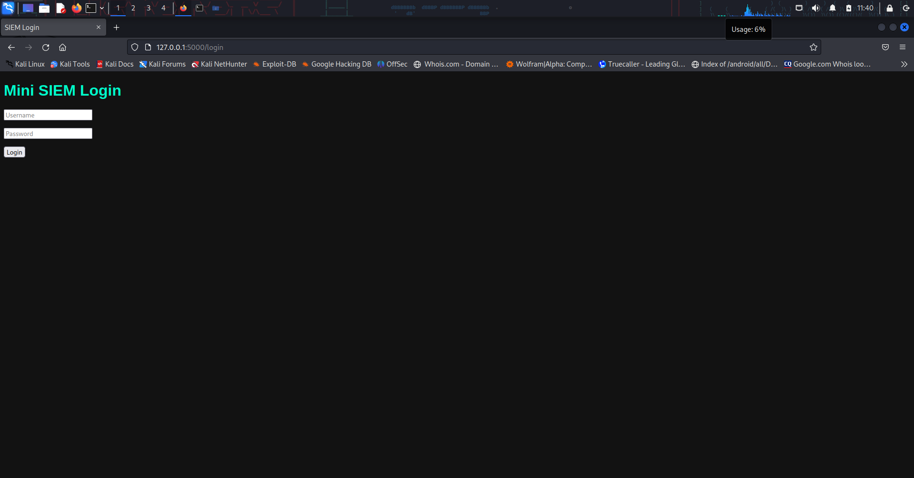
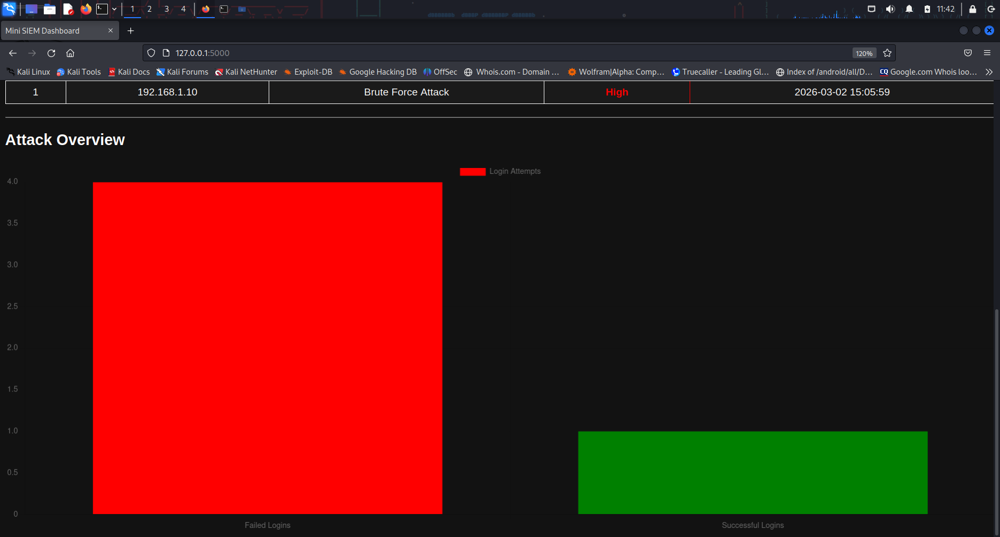
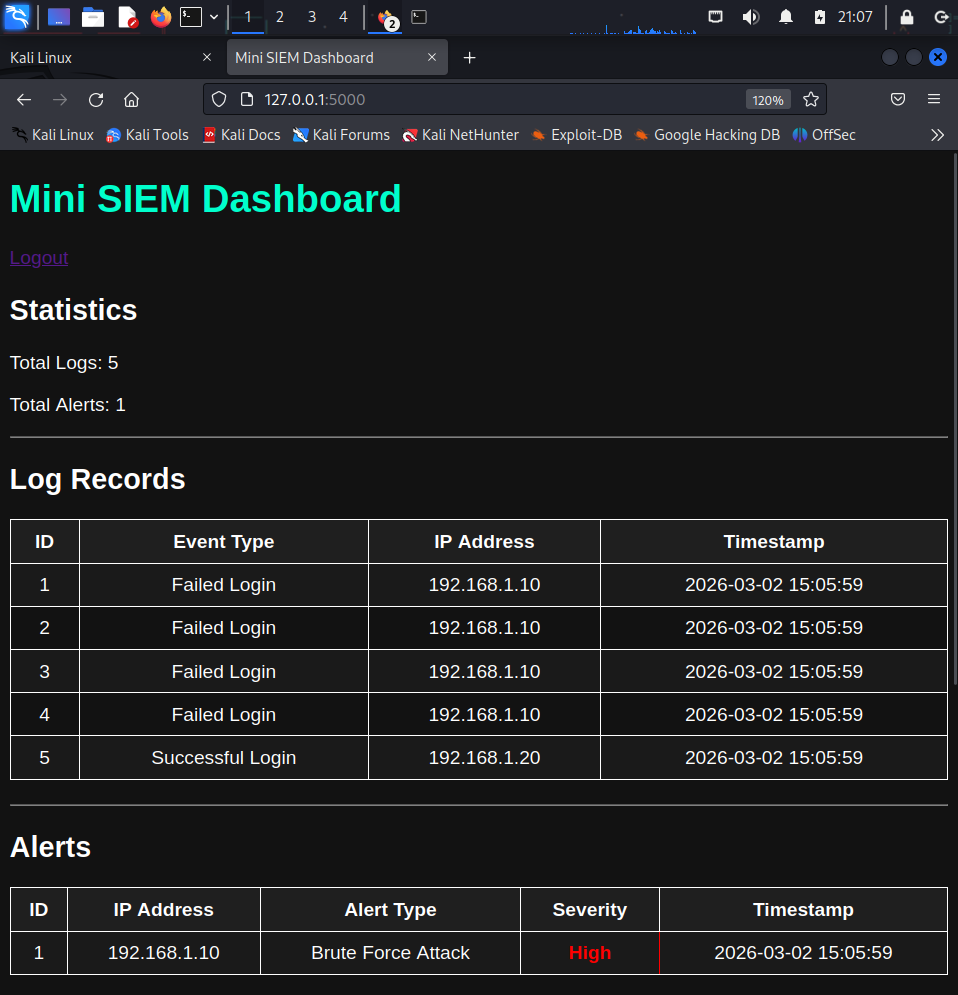

# Mini SIEM – Network Security Monitoring Lab n ####hrllp 

A lightweight **Security Information and Event Management (SIEM)** system built using Python and Flask.
This project simulates cyber attacks, detects malicious behavior, and visualizes security events through a SOC-style dashboard.


hello i am 


hhrlrl
---

## Project Overview

This project demonstrates how security monitoring systems work inside a **Security Operations Center (SOC)**.

The system simulates network activity, analyzes logs for suspicious behavior, generates alerts, and provides a real-time monitoring dashboard.

It detects attacks like:

* Brute Force Login Attempts
* Port Scanning Activity

It also performs **automated defensive actions** by blocking attacker IP addresses.

---

## Features

* Log Ingestion System
* Brute Force Detection
* Port Scan Detection
* Alert Generation with Severity Classification
* Automated IP Blocking (Active Defense)
* Authentication System (Login & Logout)
* Real-Time SOC Dashboard
* Attack Visualization Charts
* Network Threat Level Indicator
* Top Attacking IP Analysis
* Most Targeted Ports Monitoring
* Live Attack Feed
* Auto-Refresh Monitoring

---

## Tech Stack

| Technology | Purpose            |
| ---------- | ------------------ |
| Python     | Backend logic      |
| Flask      | Web framework      |
| SQLite     | Log database       |
| HTML/CSS   | Dashboard UI       |
| Chart.js   | Data visualization |

---

## System Architecture

Attack Simulation
↓
Log Generator
↓
Detection Engine
↓
Alert System
↓
Active Defense (IP Blocking)
↓
SOC Dashboard Visualization

---

## How It Works

1. Network activity is simulated using a log generator.
2. Logs are stored in an SQLite database.
3. The detection engine analyzes logs for suspicious patterns.
4. Alerts are generated when attack thresholds are exceeded.
5. Malicious IP addresses are automatically blocked.
6. The dashboard displays logs, alerts, statistics, and attack trends.

---

## Installation

Clone the repository:

```
git clone https://github.com/Rahul-Cyberr/mini-siem.git
```

Move into the project folder:

```
cd mini-siem
```

Install dependencies:

```
pip install flask
```

Run the application:

```
python app.py
```

Open in browser:

```
http://127.0.0.1:5000
```

---

## Screenshots

### Login Page



### Dashboard



### Alerts



---

## Future Improvements

* Real Packet Sniffing (Scapy)
* Nmap Scan Detection
* Email Alerting System
* Docker Deployment
* Geo-IP Attack Visualization

---

## Author

Rahul

Cybersecurity Student | Network Security Enthusiast
